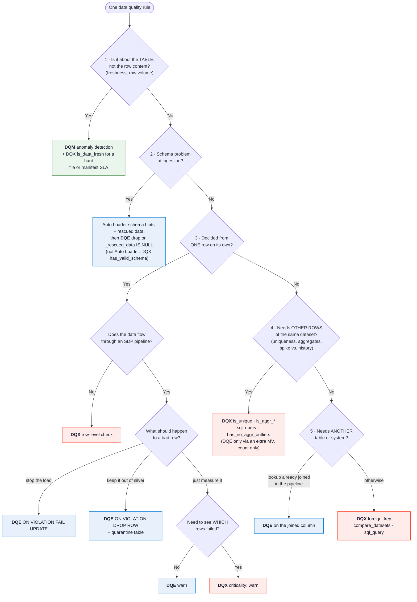

# Data Quality on Databricks: DQE vs DQX — FAQ

*October 2026 · based on a working demo in this repo*

**DQE** = Data Quality **Expectations** in Lakeflow Spark Declarative Pipelines (SDP, formerly DLT).
**DQX** = Databricks Labs **DQX**, an open-source PySpark data quality framework.
A third capability, **Data Quality Monitoring (DQM)** in Unity Catalog, comes up throughout because it covers what neither of the other two is built for.

A working demo of both frameworks on synthetic wealth-management-style data accompanies this FAQ (see [Demo and assessment](#demo-and-assessment)).

---

## 1. The basics

### Q1. What is DQE?
Expectations are constraints declared on an SDP streaming table or materialized view. Each one is a SQL boolean expression plus an action for rows that fail:

| Action | SQL | Python | Effect |
|---|---|---|---|
| warn (default) | `EXPECT (expr)` | `@dp.expect` | Row is kept; failure is counted |
| drop | `EXPECT (expr) ON VIOLATION DROP ROW` | `@dp.expect_or_drop` | Row is removed from the target |
| fail | `EXPECT (expr) ON VIOLATION FAIL UPDATE` | `@dp.expect_or_fail` | The pipeline update stops |

Pass/fail counts per expectation are recorded in the pipeline **event log** and shown in the pipeline UI.

```sql
CREATE OR REFRESH STREAMING TABLE silver_contacts (
  CONSTRAINT contact_has_no_crd   EXPECT (crd_number IS NULL)         ON VIOLATION DROP ROW,
  CONSTRAINT company_guid_present EXPECT (company_guid IS NOT NULL)   ON VIOLATION DROP ROW,
  CONSTRAINT meeting_flag_ok      EXPECT (activity_type <> 'appointment' OR mtg_flag = 'Y')
) AS SELECT * FROM STREAM(bronze_contacts);
```

### Q2. What is DQX?
DQX is a Python library from Databricks Labs (`pip install databricks-labs-dqx`). You define checks in YAML/JSON or Python, apply them to any Spark DataFrame (batch or streaming, inside or outside SDP), and get back either:
- the input with two extra columns, `_errors` and `_warnings`, listing for each row **which check failed, the message, and the columns involved**; or
- two DataFrames: valid rows and quarantined rows.

```yaml
- name: contact_guid_unique
  criticality: warn
  check: {function: is_unique, arguments: {columns: [contact_guid]}}
- name: activity_contact_exists
  criticality: error
  check: {function: foreign_key, arguments: {columns: [contact_guid], ref_columns: [contact_guid], ref_table: main.sales.contacts}}
```

### Q3. And Data Quality Monitoring (DQM)?
DQM is a Unity Catalog product that watches tables **after** they are written. With anomaly detection enabled on a schema, it learns each table's normal commit pattern and row volume, and flags freshness and completeness problems without any rules. It also offers data profiling (column statistics and drift over time). Results land in the system table `system.data_quality_monitoring.table_results`. DQM does not check row content against business rules; that is what DQE and DQX are for.

### Q4. Are DQE and DQX competitors?
No. They overlap on simple row rules, but they are built for different jobs:
- **DQE** is the enforcement layer **inside a pipeline**: declarative, zero extra code, part of the supported product.
- **DQX** is a **rules engine**: richer checks (dataset-level, cross-table, reconciliation, anomaly), per-row failure detail, and it runs anywhere Spark runs, including inside SDP.
- **DQM** is **monitoring at rest**: freshness and volume anomalies across every table, with no rules to write.

Most customers end up using two or three together (see Q21).

---

## 2. Capabilities

### Q5. Which types of rules can each one express?

| Rule type | DQE | DQX |
|---|---|---|
| Row-level (not null, regex, range, list, SQL expression) | ✅ | ✅ |
| Conditional / multi-column row rules | ✅ (SQL expression) | ✅ |
| Uniqueness / primary key | ⚠️ Workaround: group-by MV + expectation | ✅ `is_unique` |
| Foreign key / referential integrity | ⚠️ Workaround: join reference data in the flow | ✅ `foreign_key` |
| Aggregates (count, sum, avg vs. a limit, per group) | ⚠️ Workaround: MV | ✅ `is_aggr_*` |
| Spike vs. historical average, outliers | ⚠️ Workaround: MV with window functions | ✅ `sql_query`, `has_no_outliers`, `has_no_aggr_outliers` |
| Freshness | ⚠️ Workaround: MV over a manifest | ✅ `is_data_fresh`, `is_data_fresh_per_time_window` (DQM also covers this) |
| Schema validation | ✅ Auto Loader schema hints + rescued data column | ✅ `has_valid_schema` |
| Dataset comparison / reconciliation | ❌ | ✅ `compare_datasets` |
| PII detection | ❌ | ✅ (`[pii]` extra) |
| Custom Python check functions | ❌ (SQL only) | ✅ |

### Q6. Does either tell me *why* a specific row failed?
- **DQX: yes.** Each failing row carries the check name, message, function, columns, and any `user_metadata` you attach (owner, dimension, rule ID).
- **DQE: only counts.** The event log records how many rows passed and failed each expectation. To see the rows themselves you build a quarantine table (Q8). With **warn** expectations the failing rows stay in the target with no marker, so you know *how many* failed but not *which*.

In the demo both frameworks caught all 627 planted defects, but DQE could point to the failing rows for only 11 of the 17 rule types. For the other 6 (warn rules and every dataset-level rule) it gives a count only. DQX identified the rows for all 17.

### Q7. What happens to bad rows? Can the pipeline keep running?
Both let the pipeline keep running when bad records arrive:
- DQE `DROP ROW` removes them; `warn` keeps them; only `FAIL UPDATE` stops the pipeline.
- DQX never stops anything by itself. You decide what to do with `_errors` and `_warnings`: quarantine, keep with flags, or raise.
- For schema violations, use Auto Loader's **rescued data column** (`_rescued_data`). A value that doesn't fit the schema lands there instead of failing the stream, and a rule can quarantine the row. The demo does this for non-numeric AUM values.

### Q8. How does quarantine work in each?
- **DQX**: built in. `apply_checks_and_split` (or `apply_checks_by_metadata_and_split`) returns valid and quarantined DataFrames, and the quarantined rows keep their failure reasons.
- **DQE**: a documented pattern rather than a feature. Define a second table over the same source that keeps rows where any drop rule is false. The demo's `quarantine_*` tables also record the names of the rules each row failed. It works well, but it means maintaining the inverted logic.

### Q9. Streaming support?
Both support streaming. DQE expectations work on streaming tables natively. DQX row-level checks work on streaming DataFrames, including inside an SDP `@dp.table` function. Dataset-level DQX checks (uniqueness, aggregates) need the full set of data, so in streaming they apply per micro-batch; run them on the persisted table as well for whole-table guarantees.

### Q10. Can I run DQX inside an SDP pipeline?
Yes, and the demo includes a working pipeline that does it (`dqx-in-sdp-demo`). The recommended shape:

1. **Load the rules from the same Delta checks table** the batch DQX job uses, so there is one rule set.
2. **Row-level checks go on the stream.** DQX adds `_errors` / `_warnings` to every row in a temporary view.
3. **Silver** reads the view and has one DQE expectation, "no DQX errors", with drop. DQX decides; DQE records pass/fail counts in the event log and pipeline UI. Rows with only warnings are kept, with the reasons attached.
4. **Quarantine** reads the same view and keeps rows with `_errors`, so each bad row carries its rule name and message.
5. **Dataset-level checks** (`is_unique`, `foreign_key`, `sql_query`, aggregates) need the whole table rather than one micro-batch, so they run in a **materialized view** over a batch read.

```python
from databricks.labs.dqx.config import TableChecksStorageConfig
from databricks.labs.dqx.engine import DQEngine
from databricks.sdk import WorkspaceClient
from pyspark import pipelines as dp
from pyspark.sql import functions as F

dq_engine = DQEngine(WorkspaceClient())
DATASET_FUNCTIONS = {"is_unique", "foreign_key", "sql_query", "compare_datasets", "is_aggr_not_greater_than"}  # ...

checks = dq_engine.load_checks(TableChecksStorageConfig(location="main.fas_dq.dqx_checks", run_config_name="activities"))
row_checks = [c for c in checks if c["check"]["function"] not in DATASET_FUNCTIONS]
dataset_checks = [c for c in checks if c["check"]["function"] in DATASET_FUNCTIONS]

@dp.temporary_view(name="activities_checked")
def activities_checked():
    return dq_engine.apply_checks_by_metadata(spark.readStream.table("main.sales.bronze_activities"), row_checks)

@dp.table(name="silver_activities")
@dp.expect_or_drop("dqx_no_errors", "_dqx_error_count = 0")      # DQX decides, DQE records the counts
def silver_activities():
    return (spark.readStream.table("activities_checked")
            .withColumn("_dqx_error_count", F.when(F.col("_errors").isNull(), 0).otherwise(F.size("_errors")))
            .drop("_errors"))                                       # _warnings kept on silver rows

@dp.table(name="quarantine_activities")
def quarantine_activities():
    return spark.readStream.table("activities_checked").where("_errors IS NOT NULL")

@dp.materialized_view(name="dq_dataset_activities")                 # uniqueness / FK over the whole table
def dq_dataset_activities():
    ref = {"contacts": spark.read.table("main.sales.bronze_contacts")}
    out = dq_engine.apply_checks_by_metadata(spark.read.table("main.sales.bronze_activities"), dataset_checks, ref_dfs=ref)
    return out.where("_errors IS NOT NULL OR _warnings IS NOT NULL")
```

Install DQX on the pipeline through its environment (in a bundle: `environment: {dependencies: [databricks-labs-dqx]}` on a serverless pipeline).

Two details that matter:
- Compute the error count with `when(_errors IS NULL, 0)`, not `coalesce(size(_errors), 0)`. Depending on settings, Spark's `size(NULL)` can return `-1`, and the expectation would then drop every clean row.
- Every flow re-applies the row checks to the view. They are cheap Spark expressions, but if you have many checks on a wide stream, make the checked dataset a private streaming table instead of a view.

In the demo, the SDP version and the batch DQX job produced identical results: silver/quarantine 4,815/210 for contacts, 19,885/165 for activities and 10,370/45 for AUM. The expectation's event-log counts matched the quarantine tables exactly. DQX can also generate SDP expectations from profiles (`DQDltGenerator`), so a single profiling pass can feed both engines.

### Q11. Can rules be stored as metadata rather than in code?
Both support this.
- **DQE**: keep rules in a Delta table or JSON file and load them at pipeline start into `expect_all` / `expect_all_or_drop` (the demo loads `dqe_rules.json`). This is how frameworks such as `sdp-meta` / `dlt-meta` drive DQE.
- **DQX**: built-in storage backends, including workspace files, Unity Catalog volumes and **Delta tables**. `save_checks` and `load_checks` handle versioned rule sets keyed by run config. The demo stores all checks in `dqx_checks` and loads them back at run time.

### Q12. Can rules be generated rather than written by hand?
- **DQX** profiles a table and proposes candidate checks (not-null, ranges, allowed values, and so on). It also offers AI-assisted generation from natural-language requirements, for example *"Third-party identifier must be a lowercase UUID"*. In the demo, the profiler proposed 19 candidate checks for `contacts` with no input (`dqx_generated_candidates`).
- **DQE** has no generator of its own, but DQX can emit expectations from a profile.
This addresses a common pain point: writing the first rule set for a new table by hand takes hours.

---

## 3. Operations and visibility

### Q13. How do I make DQ status visible within minutes of each load?
- DQE metrics are in the event log as soon as each flow finishes. Publish the event log to Unity Catalog (`event_log` setting, as in the demo) and query it from an AI/BI dashboard or a SQL alert.
- DQX results are ordinary Delta tables (the annotated table, plus a summary table if you write one), available as soon as the job writes them.
- The demo dashboard combines both, along with the ground-truth scorecard. Add a SQL alert on `failed_rows > threshold` to notify owners.

### Q14. Is there a UI for business users to author rules?
- **DQE**: rules live in pipeline code or a rules table, so engineers own them.
- **DQX**: **DQX Studio**, a Databricks App, provides no-code rule authoring, AI-assisted suggestions, dry runs, approval workflow (author → approver), scheduling, and bad-record inspection. It suits teams where data stewards know the rules and data engineers run the pipelines.

### Q15. Performance overhead?
- **DQE** expectations compile into the flow's query plan, so overhead is minimal.
- **DQX** row checks are native Spark expressions, evaluated together in one pass with no UDFs (except PII detection). Dataset-level checks add a join or aggregation per check.
- In the demo, applying 7 checks to 20,000 activity rows, including uniqueness and a foreign-key join, took about 11 seconds on serverless, writes included (`dqx_run_timings`). Most of that is fixed overhead, so it should not be extrapolated linearly.

### Q16. Which compute does each run on?
- DQE runs wherever SDP runs, including serverless.
- DQX runs on serverless, job, and all-purpose clusters, and inside SDP. It does **not** run on SQL warehouses because it is a Python library.

### Q17. How does CI/CD work?
Both fit a Declarative Automation Bundle (DAB):
- DQE rules ship with the pipeline code or rules file.
- DQX checks ship as YAML in the repo and are validated in CI with `DQEngine.validate_checks` (the demo validates before saving).
- The demo repo is a single bundle containing both pipelines, the job, and the schema/volume.

---

## 4. Support, licensing, roadmap

### Q18. Is DQX supported by Databricks?
DQX is a **Databricks Labs** project. It is maintained by Databricks engineers and Professional Services, with best-effort support through GitHub issues; it is not covered by a support SLA. It is widely used in production (hundreds of customers). DQE is part of the core product and covered by standard support.

### Q19. Licensing and lock-in?
DQX is open source under the Databricks license, which permits use **on Databricks**; it requires a workspace client at runtime. Checks are plain YAML/JSON and SQL expressions, so they are portable to other engines with modest effort. DQE expectations are SDP syntax, so they run only in SDP.

### Q20. What's the roadmap relationship?
DQX and DQM are converging: DQX results are planned to appear in DQM (quality health indicators and system tables), and DQM is adding custom SQL checks. Rules written for DQX today should carry forward.

---

## 5. Decision tree: when to use what

Walk each rule through the tree from the top; the first branch that matches decides where the rule goes. Then check the overrides below the tree.



Legend: blue = DQE, red = DQX, green = DQM.

**Overrides** (apply after the tree):

| If… | Then… |
|---|---|
| You must know *which* rows failed and *why* (audit, triage, data stewards fixing records) | Use DQX for that rule, even if DQE could express it |
| Business users author or approve the rule | Author it in **DQX Studio**, whichever engine runs it |
| A product support SLA is mandatory for the rule | Prefer DQE and DQM; DQX is Databricks Labs with best-effort support |
| The workload runs only on a SQL warehouse (no Python) | DQE expectations on SQL-defined streaming tables or MVs, or a SQL alert; DQX needs Python compute |
| The same rule must run in both streaming and batch | Define it once in the rules registry (Q24) and generate both |

**Examples**

| Rule | Branch | Lands in |
|---|---|---|
| Gold snapshot table refreshed by 06:00 | 1 · table state | DQM |
| Incremental source file landed within 12h | 1 · table state, hard SLA | DQM + DQX `is_data_fresh` |
| Source values match the expected schema | 2 · schema at ingestion | Auto Loader rescued data + DQE |
| Third-party identifier is a lowercase UUID | 3 · one row, in SDP, keep out of silver | DQE drop + quarantine |
| Appointments are flagged as meetings | 3 · one row, measure only | DQE warn (DQX if stewards need the rows) |
| One row per credited activity GUID | 4 · other rows | DQX `is_unique` |
| Advisor AUM within 3x its 12-month average | 4 · other rows | DQX `sql_query` / `has_no_aggr_outliers` |
| Credited flag matches the credit dimension (already joined) | 5 · other table, joined in-flow | DQE |
| CRM email matches the vendor feed | 5 · other system | DQX `compare_datasets` |

---

## 6. Recommendation

### Q21. Which should we use?
**Both, with a clear split, plus DQM for freshness.** This is the decision tree (section 5) applied to a typical rule set.

| Layer | Use | For |
|---|---|---|
| Bronze | Auto Loader rescued data + DQE | Schema violations never stop ingestion |
| Silver (inline) | **DQE** `expect_or_drop` + quarantine | Row-level completeness, validity and format rules: native, supported, no extra code |
| Silver/Gold (dataset) | **DQX** | Uniqueness, foreign keys, reconciliation (raw→silver→gold), spike vs. history, per-row failure reasons |
| All tables | **DQM** anomaly detection | Freshness / volume SLAs (the 12-hour file checks) with no rules to maintain |
| Visibility | AI/BI dashboard + SQL alerts over the event log, DQX results and DQM system tables | One status view per rule |

### Q22. How do common rule patterns split?
From the pattern mapping in the demo (`rule_pattern_mapping`, 18 patterns):
- **DQE**: 7 row-level patterns (required fields, conditional requirements, formats, dates, allowed values, flag consistency, schema match).
- **DQX**: 9 dataset-level or cross-table patterns (uniqueness, composite duplicates, foreign keys, layer rollups, cross-system matches, row-count reconciliation, spikes vs. history, distinct-count drift, unknown reference values).
- **DQM (+ DQX)**: 2 timeliness patterns.
- DQX can express all 18. DQE can express the 7 row-level patterns natively; the rest need materialized-view or join workarounds that report counts only. In real rule sets the dataset-level share is often larger than people expect, because spike and reconciliation checks multiply across levels (file, advisor, office, category...).

### Q23. If we have to pick one?
Pick **DQX**. It covers every pattern, gives row-level reasons, and runs inside SDP, so nothing is lost. The trade-off is Labs support instead of product support. If Labs support is a blocker, use DQE for the row rules and keep the dataset-level rules as SQL checks (MVs or SQL alerts), and accept that those report counts only.

### Q24. How do we avoid maintaining rules in two places?
Keep one **rules registry** (a Delta table) with `rule_id`, owner, dimension, criticality and framework. Generate DQE expectations and DQX checks from it at deploy time. Name rules by `rule_id` in both frameworks (as the demo does) so the dashboard can report one status per rule regardless of which engine ran it.

### Q25. Suggested next steps
1. Agree the DQE / DQX / DQM split per rule using the mapping table.
2. Stand up the rules registry and the shared DQ dashboard.
3. Pilot DQX Studio with data stewards for rule authoring and approval.
4. Enable DQM anomaly detection on the silver and gold schemas.

---

## Demo and assessment
Synthetic wealth-management-style data: 5,025 contacts, 20,050 activities, 10,415 advisor-month AUM rows and a file manifest. 627 defects were planted across 17 rule types. Both frameworks ran the same rules (same rule IDs) on the same bronze tables.

| | DQE (SDP expectations) | DQX |
|---|---|---|
| Defects caught | 627 / 627 | 627 / 627 |
| False positives | 0 | 0 |
| Rule types where the failing rows are identified | 11 / 17 | 17 / 17 |
| Extra objects needed for dataset-level rules | 5 MVs + 1 join | none (built-in checks) |
| Silver / quarantine rows (contacts) | 4,815 / 210 | 4,815 / 210 |
| Rule storage | JSON file loaded at pipeline start | Delta checks table (`dqx_checks`) |

**Takeaway:** on detection the two frameworks are equal. The difference is effort and visibility. Every dataset-level rule took extra objects in DQE and still reported only a count, while DQX reported each failing row and the reason. See the [README](../README.md) for what is deployed and how to rerun it.
